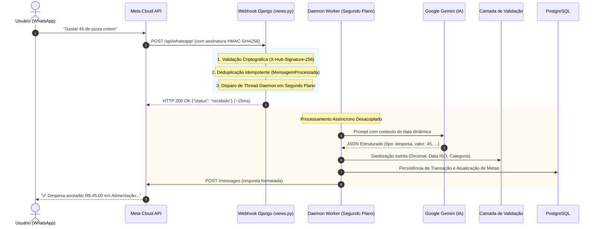

# 🪙 Kofrim — Assistente Financeiro Autônomo com IA & WhatsApp

<p align="center">
  
  
  
  
  
  
</p>

O **Kofrim** é uma solução de engenharia de software desenvolvida para eliminar a fricção do registro financeiro pessoal. Em vez de interfaces tradicionais com dezenas de campos ou planilhas manuais, o usuário conversa naturalmente via **WhatsApp**. 

O sistema utiliza **Inteligência Artificial (Google Gemini)** para interpretar intenções em linguagem natural, valida e sanitiza rigorosamente os dados monetários e persiste o estado financeiro em um banco de dados relacional **PostgreSQL**, fornecendo feedbacks imediatos de saldo, limites de gastos e progresso de metas.

---

## 🏛️ Arquitetura de Software e Fluxo de Dados

A aplicação adota uma arquitetura em camadas com separação estrita de responsabilidades, garantindo segurança criptográfica, baixa latência e resiliência contra falhas de rede.



---

## ⚡ Decisões de Engenharia e Destaques Técnicos

### 1. Processamento Assíncrono com Daemon Thread (Zero Timeout)
* **O Desafio:** A Meta Cloud API exige resposta `HTTP 200` em menos de **3 a 5 segundos** para o webhook. Chamadas de LLM (Gemini) e conexões de banco podem eventualmente ultrapassar essa janela sob instabilidade de rede, fazendo a Meta presumir que o servidor caiu e reenviar a mesma mensagem em loop.
* **A Solução:** Implementação de processamento assíncrono controlado via flag `WEBHOOK_ASSINCRONO`. A requisição é autenticada, deduplicada e o webhook responde imediatamente `HTTP 200` à Meta em **~15ms**. O trabalho pesado é delegado a uma `threading.Thread(daemon=True)`.
* **Gerenciamento de Recursos:** A thread executa sob um bloco `try ... finally` invocando explicitamente `django.db.connection.close()`, garantindo que cada thread independente encerre sua conexão e não esgote o pool do PostgreSQL.

### 2. Idempotência e Resiliência contra Reenvios
* Redes móveis frequentemente duplicam requisições. O Kofrim utiliza o modelo `MensagemProcessada` com constraint de unicidade no identificador único da Meta (`message_id` / `wamid`).
* Reenvios da mesma mensagem são interceptados na camada inicial (padrão *Early Return* / *Guard Clauses*), respondendo `HTTP 200 {"status": "duplicado"}` sem acionar a IA ou duplicar despesas no banco.

### 3. Autenticação e Segurança Criptográfica
* **Validação GET:** Handshake oficial da Meta com `hub.verify_token` via comparação resistente a ataques de temporização (`hmac.compare_digest`).
* **Validação POST:** Toda requisição da Meta é verificada via HMAC-SHA256 comparando o cabeçalho `X-Hub-Signature-256` contra o segredo `WHATSAPP_APP_SECRET`. Requisições não assinadas ou forjadas são bloqueadas com `HTTP 403 Forbidden`.
* **Isolamento Multi-tenant:** Toda query de consulta, edição ou exclusão é filtrada estritamente pelo telefone do usuário autenticado na sessão, impedindo acesso indevido entre contas.

### 4. Camada de Validação e Sanitização Defensiva (`validacao_service.py`)
* **Precisão Financeira:** Valores monetários são convertidos e tratados exclusivamente via `Decimal` (Python `decimal.Decimal`), eliminando problemas clássicos de arredondamento de ponto flutuante binário (`float`).
* **Sanitização de Payloads:** Proteção contra `NaN`, `Infinity`, valores negativos, strings malformadas e categorias inexistentes antes de qualquer toque no banco de dados.

### 5. Inteligência Artificial com Extração Determinística (Google Gemini)
* Utilização da biblioteca oficial de ponta **`google-genai`** com o modelo `gemini-3.8-flash`.
* Saída estritamente em **JSON estruturado** (`response_mime_type="application/json"` e `temperature=0.0`).
* **Contexto Temporal Dinâmico:** Injeção automática da data atual real e de ontem em cada chamada (`timezone.localdate()`), permitindo à IA resolver datas relativas com precisão (*"ontem"*, *"semana passada"*, *"mês que vem"*).
* **Modo Mock Integrado:** Em ambiente de desenvolvimento (`DEBUG=True`), suporta o prefixo `!mock <JSON>` para testes locais sem consumo de cota da API. Esse bypass é bloqueado silenciosamente em produção.

---

## 🎯 Regras de Negócio e Funcionalidades

| Recurso | Descrição | Exemplo de Uso |
|---|---|---|
| **Adição de Despesas** | Classifica automaticamente em 6 categorias: `alimentacao`, `saude`, `servicos`, `transporte`, `lazer` e `outros`. Suporta datas retroativas. | *"Gastei 45 de pizza ontem"* |
| **Adição de Receitas** | Registra entradas financeiras associadas ao saldo do usuário. | *"Recebi 1500 de freela dia 10"* |
| **Metas Financeiras** | Define metas com prazo futuro ou abertas. Acompanha progresso com barra visual e avisa ao substituir meta anterior. | *"Quero juntar 5000 até dezembro para viagem"* |
| **Limite Diário Inteligente** | Calcula a economia diária necessária com base no orçamento mensal e monitora em tempo real se o usuário estourou o limite do dia. | *"Você ainda pode gastar R$ 35,00 hoje."* |
| **Extrato Inteligente** | Filtra por subtipos (`despesas`, `receitas`, `ambos`), períodos (`dia`, `semana`, `mes`, `ano`) e múltiplos períodos. | *"Extrato dos últimos 2 meses"* |
| **Edição e Exclusão** | Permite alterar valor, descrição, categoria ou apagar transações por ID próprio com isolamento total. | *"Altera o valor do registro 3 para 90"* |
| **Onboarding Invisível** | Cadastro 100% automático no primeiro contato financeiro. Mensagens não financeiras ("Oi", dúvidas) acionam menu de ajuda sem gravar registros inválidos. | *"Como você funciona?"* |
| **Filtro de Mídia** | Mensagens de áudio, fotos ou figurinhas recebem aviso amigável sem acionar custos de IA. | Envio de imagem / áudio |

---

## 🧪 Qualidade e Testes Automatizados

O projeto conta com uma suíte abrangente de **77 testes automatizados** (unitários e de integração), cobrindo 100% dos caminhos críticos da aplicação:

```bash
python manage.py test core --noinput
```

```text
Found 77 test(s).
Creating test database for alias 'default'...
System check identified no issues (0 silenced).
.............................................................................
----------------------------------------------------------------------
Ran 77 tests in 4.821s

OK
Destroying test database for alias 'default'...
```

### Matriz de Cobertura dos Testes:
* ✅ **Receitas e Despesas:** Validação de todas as 6 categorias, datas passadas, formatação de moeda brasileira (`R$`).
* ✅ **Metas e Orçamento:** Cálculos de limites diários, metas com e sem prazo, substituição de metas existentes, cálculo de economia necessária.
* ✅ **Extratos e Filtros:** Subtipos de transações, granularidades de tempo e suporte a quantidades múltiplas.
* ✅ **Segurança e Idempotência:** Verificação GET da Meta, assinatura HMAC POST, bloqueio de `!mock` em produção e deduplicação por `message_id`.
* ✅ **Isolamento de Usuários:** Garantia de que dados de um usuário são inacessíveis por outro em consultas, edições e exclusões.

---

## 🛠️ Stack Tecnológica

* **Linguagem:** Python 3.11+
* **Framework Web:** Django 6.1+
* **Banco de Dados:** PostgreSQL 16+ (Driver `psycopg2-binary`)
* **Inteligência Artificial:** Google Gemini API (`google-genai` SDK oficial, modelo `gemini-3.8-flash`)
* **Servidor WSGI para Produção:** Gunicorn
* **Servidor de Arquivos Estáticos:** WhiteNoise com `CompressedManifestStaticFilesStorage`
* **Configuração e Ambiente:** `python-decouple`

---

## 🚀 Como Executar o Projeto Localmente

### 1. Clonar o Repositório e Criar o Ambiente Virtual
```bash
git clone https://github.com/seu-usuario/kofrim.git
cd kofrim

python -m venv venv
# No Windows:
.\venv\Scripts\activate
# No Linux/Mac:
source venv/bin/activate
```

### 2. Instalar as Dependências
```bash
pip install -r requirements.txt
```

### 3. Configurar as Variáveis de Ambiente
Copie o arquivo de exemplo e preencha com as suas credenciais:
```bash
cp .env.example .env
```

Exemplo básico de configuração para testes locais:
```ini
DEBUG=True
SECRET_KEY=sua-secret-key-local
ALLOWED_HOSTS=localhost,127.0.0.1,.ngrok-free.app,.ngrok-free.dev

# Banco de Dados PostgreSQL
DB_NAME=kofrim
DB_USER=postgres
DB_PASSWORD=sua_senha
DB_HOST=localhost
DB_PORT=5432

# Google Gemini API
GEMINI_API_KEY=sua_chave_do_google_ai_studio

# WhatsApp Cloud API (opcional para testes com !mock)
WHATSAPP_VERIFY_TOKEN=kofrim_token_2026
WHATSAPP_APP_SECRET=seu_app_secret
WHATSAPP_ACCESS_TOKEN=seu_access_token
WHATSAPP_PHONE_NUMBER_ID=seu_phone_number_id
WEBHOOK_ASSINCRONO=False
```

### 4. Executar as Migrações do Banco
```bash
python manage.py migrate
```

### 5. Executar os Testes Automatizados
```bash
python manage.py test core --noinput
```

### 6. Iniciar o Servidor de Desenvolvimento
```bash
python manage.py runserver 8000
```

---

## 📄 Licença

Este projeto está sob a licença MIT. Veja o arquivo `LICENSE` para mais detalhes.
